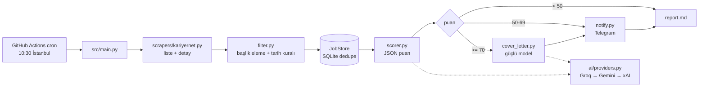

# Job Hunter

> **English summary.** Job Hunter is a small Python 3.11+ pipeline that scans Kariyer.net, LinkedIn
> (guest search, no login), Indeed TR, Secretcv and Yenibiriş every morning for ads posted in the last 24 hours, removes duplicates with SQLite and scores each new ad
> against the candidate's CV with an LLM chain (Groq first, Gemini as fallback, xAI Grok optional).
> Good matches are sent to Telegram. For the best ones it also drafts a cover letter in the ad's
> language. It runs on GitHub Actions on a daily cron, uses only `requests`, `beautifulsoup4`,
> `lxml` and `python-dotenv` (no LLM SDKs), and its test suite runs fully offline with mocks.

---

## Ne yapar?

Her sabah 10:30'da (İstanbul):

1. Kariyer.net'te `profile/preferences.md` içindeki arama sorgularıyla ilanları tarar.
2. Başlığa göre eler (junior, stajyer, Java, frontend, mobil…). Son 24 saatte yayınlanmamış ilanları atar.
3. Daha önce görülmüş ilanları SQLite (`data/jobs.db`) ile ayıklar.
4. Yeni ilanları CV ve tercihlerle karşılaştırıp LLM'e **0-100 arası** puanlatır.
5. 50 ve üzeri puan alan ilanları Telegram'a bildirir. 70 ve üzeri puan alanlara ilanın dilinde bir **ön yazı** taslağı ekler.
6. `output/YYYY-MM-DD/report.md` dosyasına günlük bir rapor yazar.

## Mimari



```
src/
  main.py            CLI ve pipeline
  config.py          .env + preferences.md içindeki yaml bloğu (PyYAML'sız ayrıştırıcı)
  models.py          Job dataclass (uid = kaynak:id)
  dateparse.py       "Bugün", "Dün", "3 saat önce", "2 gün", "18 Ekim 2026", ISO…
  filter.py          eleme, son-24-saat kuralı, JobStore (SQLite)
  scorer.py          Türkçe prompt, sağlam JSON çıkarma, puanı 0-100 aralığına sıkıştırma
  cover_letter.py    dil tespiti, ön yazı üretimi ve kaydı
  notify.py          Telegram HTML mesajı, belge gönderme, dry-run, güvenli bölme
  report.py          günlük Markdown raporu
  redact.py          log ve hata metinlerinden gizli anahtarları temizler
  ai/providers.py    Groq / Gemini / xAI + fallback zinciri (düz requests)
  scrapers/          BaseScraper (nazik HTTP) + KariyerNetScraper
profile/             cv.md, preferences.md (puanlama kuralları + makine okunur yapılandırma)
tests/               pytest (ağ yok; mock'lar ve tmp_path)
```

## Üç katmanlı tarih kuralı

Yalnızca **bugün ve dün** yayınlanan ilanlar işlenir:

| Katman | Nerede | Ne yapar |
|---|---|---|
| 1. URL tarih filtresi | scraper | Sitenin "Bugünün ilanları" parametresi (`DATE_PARAMS`). Kariyer.net için parametre **henüz doğrulanmadı**, bu yüzden şimdilik boş. |
| 2. Göreli tarih ayrıştırma | `dateparse.py` + `filter.is_recent` | Karttaki "1 saat", "Dün", "2 gün" gibi metinler tarihe çevrilir ve dünden eski ilanlar elenir. Tarihi okunamayan ilan elenmez, `date_unknown` olarak işaretlenir. |
| 3. first_seen dedupe | `JobStore` | Her ilan `kaynak:id` ile ilk görüldüğü günle birlikte kaydedilir. Aynı ilan bir daha bildirilmez. |

## Puan eşikleri

| Puan | Sonuç |
|---|---|
| `< 50` | Bildirim yok, yalnızca raporda görünür |
| `50-69` | 🟡 Telegram bildirimi |
| `>= 70` | 🟢 Telegram bildirimi + ön yazı (`.md` belgesi ekte) |

Eşikler `profile/preferences.md` içindeki yaml bloğunda tanımlıdır (`min_score_notify`,
`min_score_cover_letter`). Kesin eleme kriterlerine takılan ilanlar en fazla 20 puan alır.

Örnek bildirim:

```
🟢 82/100 – Senior .NET Developer – XYZ Fintech (İstanbul, hibrit)
Eşleşen: .NET, bankacılık · Eksik: Azure
🔗 link · 📄 ön yazı ekte
```

Ön yazılar **otomatik gönderilmez**. Her dosyanın başında "Göndermeden önce oku ve kendi cümlelerinle
düzelt." uyarısı bulunur. Model CV'de olmayan bir deneyim yazmamakla yönlendirilir.

## AI sağlayıcı zinciri

`AI_PROVIDERS` değişkenindeki sırayla denenir (varsayılan sadece `groq`; yedek istersen `groq,gemini`). HTTP hatası, zaman aşımı,
429 ya da bozuk yanıt alınırsa sıradaki sağlayıcıya geçilir. 429'da kısa bir beklemeden sonra bir kez
yeniden denenir. Hepsi başarısız olursa ilan puansız kalır ve bir sonraki çalıştırmada tekrar denenir.

| Sağlayıcı | Hızlı model (puanlama) | Güçlü model (ön yazı) | Ücretsiz anahtar |
|---|---|---|---|
| **Groq** (birincil) | `qwen/qwen3.5-27b`, `openai/gpt-oss-120b` | aynı | <https://console.groq.com/keys> → *Create API Key* |

Model listesi sırayla denenir. Groq bir modeli kaldırırsa (`model_not_found`) sıradakine geçilir; hiçbiri kalmazsa hesabın erişebildiği modeller `/models` ile otomatik bulunur (adı listedekine benzeyen model, örn. başka bir Qwen 3.5 27B kimliği, önce denenir). Her Telegram mesajında ve ön yazı dosyasında hangi AI/modelin yazdığı görünür (`🤖 groq · qwen/qwen3.5-27b`).
| **Gemini** (yedek) | `gemini-2.0-flash` | `GEMINI_MODEL_STRONG` | <https://aistudio.google.com/apikey> → *Create API key* |
| xAI Grok (opsiyonel) | `grok-3-mini` | `grok-3` | <https://console.x.ai> (ücretli). `AI_PROVIDERS=groq,gemini,xai` |

Gemini anahtarı URL'de değil, `x-goog-api-key` başlığında gönderilir. Tüm anahtarlar loglara yazılmadan
önce `redact.py` ile maskelenir.

## Telegram kurulumu

1. Telegram'da **@BotFather** ile konuşun, `/newbot` yazın, bota bir ad ve kullanıcı adı verin.
   Size verilen token'ı `TELEGRAM_BOT_TOKEN` olarak saklayın.
2. Yeni botunuza bir mesaj gönderin (örneğin `merhaba`).
3. Tarayıcıda `https://api.telegram.org/bot<TOKEN>/getUpdates` adresini açın. Yanıttaki
   `"chat":{"id": 123456789, ...}` değeri `TELEGRAM_CHAT_ID` olur.
4. `TELEGRAM_ENABLED=true` yapın. Bu değer `false` iken ya da token veya chat id eksikken her şey
   **dry-run** çalışır: mesajlar `output/YYYY-MM-DD/telegram_dryrun.txt` dosyasına yazılır ve ağa çıkılmaz.

## Yerelde çalıştırma

```bash
python3 -m venv venv && source venv/bin/activate      # Windows: venv\Scripts\activate
pip install -r requirements.txt
cp .env.example .env                                  # anahtarları doldurun

python -m pytest -q                                   # testler (ağ gerektirmez)

# Kaydedilmiş HTML ile çevrimdışı deneme; ilk 5 ilanı tablo olarak basar
python -m src.main --dry-run --no-ai --sample-html tests/fixtures/kariyernet_list.html --print 5

python -m src.main --dry-run --limit 5                # gerçek tarama + AI, Telegram/DB'ye yazmadan
python -m src.main                                    # tam çalıştırma
```

| Bayrak | Anlamı |
|---|---|
| `--dry-run` | Telegram'a göndermez ve DB'ye kalıcı yazmaz (geçmişe göre dedupe yine yapılır) |
| `--no-ai` | Puanlama ve ön yazıyı atlar |
| `--limit N` | En fazla N yeni ilanı işler |
| `--print N` | İşlenen ilk N ilanı ekrana tablo olarak basar |
| `--sources kariyernet` | Yalnızca seçilen kaynakları çalıştırır |
| `--sample-html PATH` | Ağ yerine kaydedilmiş bir liste sayfasını ayrıştırır |

## GitHub Actions kurulumu

İş akışı: `.github/workflows/daily.yml`. Her gün 07:23 UTC'de (10:23 İstanbul, mesajlar ~10:30) çalışır; GitHub zamanlanmış işleri bazen geciktirdiği/atladığı için 12:17'de yedek çalışma var, o gün zaten çalıştıysa hiçbir şey yapmaz, *Run workflow*
ile elle de başlatılabilir. Önce testleri, sonra pipeline'ı çalıştırır. Elle çalıştırmada `mode` seçilir:

- `check`: sadece bağlantı testi. Telegram'a test mesajı atar (`TELEGRAM_ENABLED=false` olsa bile) ve her
  AI anahtarını dener; bir şey eksik/yanlışsa iş kırmızı biter. Yerelde: `python -m src.main --check`.
- `dry_run`: ilanları tarar ve puanlar, Telegram'a göndermez, veritabanına yazmaz. Sonuç *Artifacts*'ta.
- `normal`: gerçek çalıştırma (zamanlanmış çalıştırma da budur).

Her çalıştırmanın raporu, Actions'ta çalıştırma sayfasının **Summary** bölümünde tablo olarak görünür;
dosya indirmeye gerek yoktur. Telegram'da 50+ puanlı her ilan ayrı mesaj olarak gelir, günlük özet
mesajında da günün en yüksek puanlı 5 ilanı linkleriyle listelenir. Ham liste sayfaları
(`output/<gün>/raw/`) hata ayıklama için artifact'e eklenir.

`GROQ_API_KEY` alanına yanlışlıkla `xai-` ile başlayan bir xAI anahtarı girilirse otomatik olarak xAI Grok
kullanılır.
`data/jobs.db` çalıştırmalar arasında `actions/cache` ile taşınır. `output/` klasörü 14 gün saklanan
bir artifact olarak yüklenir.

**Settings → Secrets and variables → Actions:**

| Tür | Ad | Not |
|---|---|---|
| Secret | `GROQ_API_KEY` | birincil sağlayıcı |
| Secret | `GEMINI_API_KEY` | yedek sağlayıcı |
| Secret | `TELEGRAM_BOT_TOKEN`, `TELEGRAM_CHAT_ID` | bildirimler |
| Secret | `CV_MD` *(opsiyonel)* | CV metni (bkz. gizlilik) |
| Secret | `XAI_API_KEY` *(opsiyonel)* | yalnızca `xai` kullanılacaksa |
| Variable | `TELEGRAM_ENABLED` | Faz 1'de `false` (dry-run). **Faz 2'de `true`** yapın |
| Variable | `AI_PROVIDERS` *(opsiyonel)* | varsayılan `groq` |
| Variable | `GROQ_MODEL` / `GROQ_MODEL_STRONG` *(opsiyonel)* | virgülle model listesi; boşsa varsayılanlar |

## Gizlilik

- `.env`, `data/jobs.db` ve `output/` git'e girmez (`.gitignore`).
- `profile/cv.md` kişisel veridir. **Repoyu private tutun.** Repoyu public yapacaksanız `profile/cv.md`
  dosyasını `.gitignore`'a ekleyip git geçmişinden çıkarın ve CV'yi `CV_MD` secret'ı olarak verin
  (çok satırlı metin sorun çıkarırsa `CV_MD_B64` ile base64 olarak). Bu değişkenler ayarlıysa
  `profile/cv.md` yerine onlar kullanılır.
- LinkedIn'e giriş yapılmış bir hesapla scraping **yapılmaz**.

## Kaynaklar

> GitHub sunucularından Kariyer.net, Indeed TR ve Yenibiriş engelleniyor; LinkedIn çalışıyor. Türk siteleri için kendi bilgisayarında runner kurulumu: [docs/self-hosted-runner.md](docs/self-hosted-runner.md).

| Kaynak | Modül | Nasıl arar | Tarih | Risk |
|---|---|---|---|---|
| **Kariyer.net** | `kariyernet.py` | pozisyon slug'ları (`search_queries`) | "1 saat", "Dün", detayda `lastPublishDate` | düşük-orta |
| **LinkedIn** (misafir) | `linkedin.py` | `jobs-guest/.../seeMoreJobPostings/search` + `f_TPR=r86400` (`linkedin_queries` × `linkedin_locations`) | `time[datetime]` | orta |
| **Indeed TR** | `indeed.py` | `tr.indeed.com/jobs?q=…&fromage=3&sort=date` (`indeed_queries` × `indeed_locations`) | gömülü JSON `pubDate` | yüksek |
| **Secretcv** | `secretcv.py` | liste yolu (`secretcv_paths`), başlık yerelde filtrelenir | "3 gün önce", detayda `16-10-2026` | düşük |
| **Yenibiriş** | `yenibiris.py` | kategori yolu (`yenibiris_paths`) | `17.09.2026`, "Son 1 Hafta" → tarih yok | düşük |

- Hangi kaynakların çalışacağı `preferences.md` içindeki `sources` listesinden gelir. `--sources`
  bayrağı bu listeyi geçersiz kılar.
- Her kaynak bağımsızdır: biri hata verirse ya da engellenirse log'a düşer ve diğerleri devam eder.
  Log'da kaynak başına sayım görünür (`[linkedin] 23 cards`).
- **LinkedIn:** yalnızca misafir uç noktaları kullanılır, giriş ve çerez **asla** kullanılmaz. İstekler
  arasında 3-7 sn beklenir ve bir çalıştırmada en fazla 30 istek atılır. 429, 999, 403 ya da
  authwall/giriş sayfası görülürse LinkedIn o çalıştırmada atlanır.
- **Indeed:** Cloudflare/captcha sayfası ("Just a moment", hCaptcha) veya 403/429 gelirse o
  çalıştırmada atlanır.
- `--sample-html` ile verilen kayıtlı sayfa, içeriğine bakılarak ait olduğu kaynağın ayrıştırıcısına
  yönlendirilir.

## Bilinen sınırlamalar

- **Tüm ayrıştırıcılar (Kariyer.net, LinkedIn, Indeed, Secretcv, Yenibiriş) sentetik fixture'larla geliştirildi.** Geliştirme ortamı siteye
  erişemedi. İlk gerçek çalıştırmada sonuçları kontrol edin ve gerekirse gerçek bir sayfayı
  `tests/fixtures/` altına kaydedip testleri ona göre güncelleyin. Kart bulunamayan ve "Bulamadık"
  yazmayan sayfalar log'a uyarı olarak düşer.
- **Tarih URL parametresi doğrulanmadı.** Katman 1 (`DATE_PARAMS`) şimdilik boş, kuralı katman 2 ve 3
  uyguluyor.
- GitHub, repoda **60 gün boyunca aktivite olmazsa zamanlanmış iş akışlarını devre dışı bırakır**.
  Ara sıra bir commit atın ya da iş akışını elle yeniden etkinleştirin.
- GitHub runner IP'leri site tarafından hız sınırına takılabilir veya engellenebilir (403/429).
  **LinkedIn ve Indeed veri merkezi IP'lerini sıkça engeller.** Bu durumda o kaynak sessizce atlanır
  ve diğerleri çalışmaya devam eder. Sürekli engelleniyorsa yerel bir makinede cron ile çalıştırmayı
  düşünün.
- Indeed'de günlük .NET ilanı hacmi çok düşük (`fromage=1` testlerde 0 sonuç verdi), bu yüzden
  `fromage=3` ve DB dedupe kullanılıyor. Secretcv ve Yenibiriş serbest metin aramayı desteklemiyor ve
  yazılım ilanı az.
- LLM puanları rehber niteliğindedir. Son kararı ilanı okuyarak verin.

## Yol haritası

- [x] LinkedIn **misafir** araması (`f_TPR=r86400`, giriş yapmadan)
- [x] Indeed TR
- [x] Secretcv ve Yenibiriş
- [ ] Gerçek sayfalar kaydedilip sentetik fixture'ların değiştirilmesi
- [ ] Engellenen kaynak için Telegram özetinde "kaynak atlandı" notu
- [ ] Gmail'e günlük özet e-postası
- [ ] Kariyer.net tarih parametresinin doğrulanıp `DATE_PARAMS`'a eklenmesi
- [ ] Seçici kırılınca Telegram'a sağlık uyarısı gönderilmesi
